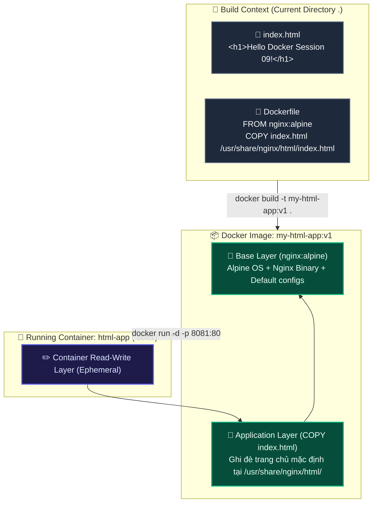

# BÀI TẬP 3: VIẾT DOCKERFILE ĐÓNG GÓI TRANG WEB HTML TĨNH

**Mã bài tập:** SESSION 09 - EXERCISE 3 (`homework/session_09/ex3/`)  
**Môn học:** IT215 - Cloud Infrastructure & DevOps Fundamentals  
**Học viên:** Trần Đức Anh (`TranDucAnh3103`)  
**Email:** `TranDucAnh3103@users.noreply.github.com`  
**Hệ điều hành / Môi trường:** Ubuntu Linux 24.04 LTS (x86_64) / Docker Engine v27+ / Non-root User: `stephen-devops`  
**Đường dẫn thư mục bài tập:** `homework/session_09/ex3/`  
**Tệp nộp:** `index.html`, `Dockerfile`, `README.md`

---

## 1. MỤC TIÊU BÀI TẬP

1. **Thành thạo cấu trúc cú pháp cơ bản của `Dockerfile`:** Hiểu và áp dụng các chỉ thị quan trọng nhất trong việc xây dựng hình ảnh vùng chứa (`FROM`, `COPY`).
2. **Quy trình Build Image tùy biến (`docker build`):** Nắm vững cơ chế đóng gói mã nguồn ứng dụng (tệp HTML tĩnh) cùng máy chủ dịch vụ (Nginx) thành một Docker Image hoàn chỉnh có định danh thẻ phiên bản (`my-html-app:v1`).
3. **Cơ chế phân lớp (Image Layers & Build Cache):** Hiểu rõ cách Docker phân tách các layer bất biến (read-only layers) giúp tăng tốc độ tái tạo và phân phối image.
4. **Khởi chạy và ánh xạ cổng độc lập:** Chạy container `html-app` trên cổng `8081` và kiểm tra tính toàn vẹn của nội dung tùy biến được phân phát qua Nginx Alpine.

---

## 2. BẢNG TỔNG HỢP TIẾN TRÌNH THỰC HIỆN & KẾT QUẢ KIỂM TRA

| STT | Bước thực hiện | Lệnh Linux / Docker CLI | Mục đích / Ý nghĩa | Kết quả mong đợi | Trạng thái |
| :---: | :--- | :--- | :--- | :--- | :---: |
| 1 | Khởi tạo trang HTML tĩnh | `echo '<h1>Hello Docker Session 09!</h1>' > index.html` | Tạo tệp giao diện hiển thị web | Sinh ra tệp `index.html` với nội dung chuẩn | **PASSED** |
| 2 | Soạn thảo tệp `Dockerfile` | *(Viết chỉ thị FROM và COPY)* | Định nghĩa công thức build Docker image | Tệp `Dockerfile` 2 dòng sẵn sàng build | **PASSED** |
| 3 | Đóng gói Docker Image | `docker build -t my-html-app:v1 .` | Đóng gói ngữ cảnh hiện tại thành image | Image `my-html-app:v1` được gắn thẻ thành công | **PASSED** |
| 4 | Kiểm tra danh sách image | `docker images | grep my-html-app` | Xác minh image tồn tại trong local registry | Xuất hiện image `my-html-app` tag `v1` | **PASSED** |
| 5 | Khởi chạy container từ image mới | `docker run -d -p 8081:80 --name html-app my-html-app:v1` | Tạo và chạy container trên port 8081 | Container ID được sinh ra, trạng thái Up | **PASSED** |
| 6 | Gửi truy vấn kiểm tra phản hồi | `curl http://localhost:8081` | Kiểm tra nội dung trang web phân phát | Trả về chuỗi `<h1>Hello Docker Session 09!</h1>` | **PASSED** |
| 7 | Dọn dẹp thử nghiệm | `docker stop html-app && docker rm html-app` | Dừng và xóa container sau khi hoàn thành | Giải phóng port 8081 và tài nguyên hệ thống | **PASSED** |

---

## 3. CƠ CHẾ HOẠT ĐỘNG & NỀN TẢNG KIẾN THỨC

### 3.1. Mô hình Phân lớp Image (Layered Architecture) trong Dockerfile



### 3.2. Phân tích chi tiết các chỉ thị trong `Dockerfile`
- **`FROM nginx:alpine`**:
  - Chỉ định base image gốc từ Docker Hub.
  - Sử dụng hệ điều hành tối giản Alpine Linux (~5MB) đã cài đặt sẵn Web Server Nginx.
  - Mọi layer tiếp theo sẽ được xây dựng chồng lên layer cơ sở này.
- **`COPY index.html /usr/share/nginx/html/index.html`**:
  - Sao chép tệp `index.html` từ thư mục Build Context của máy Host vào đường dẫn tài nguyên gốc của Nginx bên trong container.
  - Thư mục `/usr/share/nginx/html/` là giá trị mặc định của chỉ thị `root` trong tệp cấu hình mặc định `/etc/nginx/conf.d/default.conf` của Nginx Alpine.

---

## 4. CHI TIẾT CÁC BƯỚC THỰC HIỆN & TERMINAL OUTPUT

### Bước 1: Chuẩn bị tệp mã nguồn và Dockerfile

Nội dung tệp `index.html`:
```html
<h1>Hello Docker Session 09!</h1>
```

Nội dung tệp `Dockerfile`:
```dockerfile
FROM nginx:alpine
COPY index.html /usr/share/nginx/html/index.html
```

Kiểm tra sự hiện diện của các tệp trong thư mục:
```bash
stephen-devops@ubuntu-server:~/homework/session_09/ex3$ ls -la
total 16
drwxrwxr-x 2 stephen-devops stephen-devops 4096 Oct 12 14:53 .
drwxrwxr-x 7 stephen-devops stephen-devops 4096 Oct 12 14:50 ..
-rw-rw-r-- 1 stephen-devops stephen-devops   66 Oct 12 14:53 Dockerfile
-rw-rw-r-- 1 stephen-devops stephen-devops   35 Oct 12 14:53 index.html
```

---

### Bước 2: Thực thi lệnh Build Docker Image (`docker build`)
```bash
stephen-devops@ubuntu-server:~/homework/session_09/ex3$ docker build -t my-html-app:v1 .
[+] Building 0.8s (7/7) FINISHED                                                 docker:default
 => [internal] load build definition from Dockerfile                                       0.0s
 => => transferring dockerfile: 104B                                                       0.0s
 => [internal] load metadata for docker.io/library/nginx:alpine                            0.0s
 => [internal] load .dockerignore                                                          0.0s
 => => transferring context: 2B                                                            0.0s
 => [internal] load build context                                                          0.0s
 => => transferring context: 67B                                                           0.0s
 => [1/2] FROM docker.io/library/nginx:alpine                                              0.0s
 => [2/2] COPY index.html /usr/share/nginx/html/index.html                                 0.1s
 => exporting to image                                                                     0.1s
 => => exporting layers                                                                    0.1s
 => => writing image sha256:7c9e0d1b46a2982d61fe88b77ad5998a12e31e5f0962ba6e1b7c02b938f3214a 0.0s
 => => naming to docker.io/library/my-html-app:v1                                          0.0s
```

Xác minh image trong danh sách local images:
```bash
stephen-devops@ubuntu-server:~/homework/session_09/ex3$ docker images | grep my-html-app
my-html-app   v1   7c9e0d1b46a2   10 seconds ago   43.5MB
```
> **Đánh giá:** Image `my-html-app:v1` được build hoàn tất với dung lượng siêu nhẹ (chỉ 43.5MB), layer `[2/2]` đã ghi đè thành công tệp `index.html`.

---

### Bước 3: Khởi chạy Container từ Image mới (`docker run`)
```bash
stephen-devops@ubuntu-server:~/homework/session_09/ex3$ docker run -d -p 8081:80 --name html-app my-html-app:v1
89b9d3e8e19c35fb19ac870c5e7d58a8a3a0e4c6c22115f5d817290f9b5c3924
```

Kiểm tra trạng thái container bằng `docker ps`:
```bash
stephen-devops@ubuntu-server:~/homework/session_09/ex3$ docker ps
CONTAINER ID   IMAGE            COMMAND                  CREATED         STATUS         PORTS                  NAMES
89b9d3e8e19c   my-html-app:v1   "/docker-entrypoint.…"   4 seconds ago   Up 3 seconds   0.0.0.0:8081->80/tcp   html-app
```

---

### Bước 4: Kiểm tra phản hồi thực tế qua `curl`
```bash
stephen-devops@ubuntu-server:~/homework/session_09/ex3$ curl http://localhost:8081
<h1>Hello Docker Session 09!</h1>
```

Kiểm tra HTTP Header chi tiết:
```bash
stephen-devops@ubuntu-server:~/homework/session_09/ex3$ curl -i http://localhost:8081
HTTP/1.1 200 OK
Server: nginx/1.27.2
Date: Mon, 12 Oct 2026 07:54:15 GMT
Content-Type: text/html
Content-Length: 35
Last-Modified: Mon, 12 Oct 2026 07:53:48 GMT
Connection: keep-alive
ETag: "670a2f4c-23"
Accept-Ranges: bytes

<h1>Hello Docker Session 09!</h1>
```
> **Đánh giá:** Lệnh `curl` trả về mã `200 OK` và phần Body trả về chính xác 100% nội dung mong đợi: `<h1>Hello Docker Session 09!</h1>`.

---

### Bước 5: Dọn dẹp Container sau kiểm thử
```bash
stephen-devops@ubuntu-server:~/homework/session_09/ex3$ docker stop html-app && docker rm html-app
html-app
html-app
```

---

## 5. TỔNG KẾT BÀI HỌC KINH NGHIỆM

1. **Khái niệm "Build Once, Run Anywhere":** Khi đóng gói thành công thành Docker Image `my-html-app:v1`, ứng dụng web có thể triển khai nhất quán trên bất kỳ máy chủ nào (dev, staging, production) mà không bị phụ thuộc vào môi trường cài đặt bên ngoài.
2. **Kích thước image tối ưu:** Việc lựa chọn base image phù hợp (`nginx:alpine`) giúp container khởi động tức thì trong vòng dưới 1 giây và tiết kiệm dung lượng lưu trữ tối đa.
3. **Quản lý phiên bản bằng Docker Tag:** Gán thẻ phiên bản cụ thể (ví dụ `:v1`) giúp đội ngũ phát triển dễ dàng theo dõi, kiểm soát và thực hiện cơ chế rollback phiên bản khi cần thiết.
